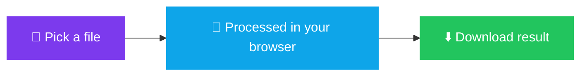

<div align="center">


<a href="https://codemaster2013.github.io/converter/">

</a>

<br><br>

[](https://codemaster2013.github.io/converter/)
[](https://codemaster2013.github.io/converter/)
[](#-privacy)


<br>


</div>

<br>

---

<div align="center">

## ✨ Why You'll Love It

</div>

<table>
<tr>
<td align="center" width="25%">

### 🔒
**Private**<br>
<sub>Files are processed on your device and never uploaded</sub>

</td>
<td align="center" width="25%">

### ⚡
**Fast**<br>
<sub>No waiting for uploads, queues or downloads</sub>

</td>
<td align="center" width="25%">

### 📴
**Offline**<br>
<sub>Works without internet after your first visit</sub>

</td>
<td align="center" width="25%">

### 📲
**Installable**<br>
<sub>Add it to your phone or desktop like a real app</sub>

</td>
</tr>
</table>

<br>

---

<div align="center">

## 🧰 All Tools

</div>

### 📄 PDF Tools

<table>
<tr>
<td width="33%" valign="top">

**🖼️ Image to PDF**<br>
<sub>Turn photos into one PDF</sub>

</td>
<td width="33%" valign="top">

**🔗 Merge PDF**<br>
<sub>Combine many PDFs into one</sub>

</td>
<td width="33%" valign="top">

**🗂️ Page Organizer**<br>
<sub>Rotate, reorder, delete, split</sub>

</td>
</tr>
<tr>
<td valign="top">

**✍️ Sign PDF**<br>
<sub>Draw a signature and place it</sub>

</td>
<td valign="top">

**🔓 Unlock PDF**<br>
<sub>Remove a password you know</sub>

</td>
<td valign="top">

**🔐 PDF Locker**<br>
<sub>Protect a PDF with a password</sub>

</td>
</tr>
<tr>
<td valign="top">

**📖 PDF Reader**<br>
<sub>Read and annotate</sub>

</td>
<td valign="top">

**🔄 PDF Converter**<br>
<sub>Word, PowerPoint, image, text</sub>

</td>
<td valign="top">

**📷 Document Scanner**<br>
<sub>Camera straight to PDF</sub>

</td>
</tr>
</table>

### 🖼️ Image Tools

<table>
<tr>
<td width="33%" valign="top">

**🔁 Image Converter**<br>
<sub>JPG, PNG and WebP</sub>

</td>
<td width="33%" valign="top">

**🍎 HEIC to JPG**<br>
<sub>Open iPhone photos anywhere</sub>

</td>
<td width="33%" valign="top">

**📉 Compress to Size**<br>
<sub>Exact 100 KB, 50 KB or 20 KB</sub>

</td>
</tr>
<tr>
<td valign="top">

**🪪 Photo & Signature Resizer**<br>
<sub>Exact pixels and KB for forms</sub>

</td>
<td valign="top">

**✂️ Remove Background**<br>
<sub>Cut out the subject</sub>

</td>
<td valign="top">

**📍 Remove EXIF / GPS**<br>
<sub>Strip location from photos</sub>

</td>
</tr>
<tr>
<td valign="top">

**🔤 Smart OCR**<br>
<sub>Image to text, English + Hindi</sub>

</td>
<td></td>
<td></td>
</tr>
</table>

### 🧩 Utilities

<table>
<tr>
<td width="33%" valign="top">

**▦ QR Generator**<br>
<sub>Make QR codes instantly</sub>

</td>
<td width="33%" valign="top">

**📸 QR Scanner**<br>
<sub>Camera or image</sub>

</td>
<td width="33%" valign="top">

**🧬 Base64 Converter**<br>
<sub>Image to Base64 and back</sub>

</td>
</tr>
</table>

<br>

---

<div align="center">

## 🎨 Looks Great Everywhere

| ☀️ Light mode | 🌙 Dark mode | 📱 Phone |
| :---: | :---: | :---: |
|  |  |  |

</div>

<br>

<table>
<tr>
<td width="50%" valign="top">

### 📱 App Experience

- 📲 Installable **PWA**
- 📴 **Offline** support
- 📤 **Share target**: send files from your phone's share sheet
- 🔗 Deep links to each tool (e.g. `?tool=ocr`)

</td>
<td width="50%" valign="top">

### 🎛️ Personalize

- 🌗 **Light and dark** mode
- 🎨 **16 app icon themes**: Classic, Forest, Space, Galaxy, Fire, Marble, Glow, Fur and more
- 🎬 Animated intro

</td>
</tr>
</table>

<br>

---

<div align="center">

## ⚙️ How It Works

</div>



> Nothing is uploaded at any step. Conversion, OCR, compression and editing all run locally with JavaScript and WebAssembly.

<br>

---

<div align="center">

## 🛠️ Built With

</div>

Plain **HTML, CSS and JavaScript**. No framework, no build step. Libraries are bundled locally so everything works offline.

| Purpose | Library |
| --- | --- |
| 📄 PDF create / edit | pdf-lib, jsPDF |
| 👁️ PDF rendering | PDF.js |
| 🔤 OCR | Tesseract.js (English + Hindi data included) |
| 🍎 HEIC conversion | heic2any |
| ▦ QR codes | qrcode, jsQR |
| 🗜️ ZIP handling | JSZip |
| 🎬 Intro effects | three.js |
| 💬 Feedback / VIP pages | Firebase |

<br>

<details>
<summary><b>📁 Project structure (click to expand)</b></summary>

```text
converter/
├── index.html              # Main app
├── *.html                  # Landing page per tool (jpg-to-pdf, merge-pdf, ...)
├── index (2..5).html       # Feedback, VIP and beta pages
├── tools.js                # Extra tools (compress, scanner, sign, EXIF, QR scan, ...)
├── pwa.js · sw.js          # PWA install logic and service worker
├── mg-*.js                 # Intro, deep links, icons, library loader
├── lib-*.js                # Bundled third-party libraries
├── *.traineddata.gz        # OCR language data (English, Hindi)
├── appicon-*               # Icon theme packs
├── manifest.webmanifest    # PWA manifest
├── sitemap.xml · robots.txt
└── 404.html · offline.html
```

</details>

<details>
<summary><b>🚀 Run locally (click to expand)</b></summary>

<br>

Service workers and camera access need a server, so don't just double-click the file.

```bash
git clone https://github.com/codemaster2013/converter.git
cd converter
python3 -m http.server 8080
```

Then open **http://localhost:8080**

</details>

<br>

---

<div align="center">

## 🔒 Privacy

Your files are **never sent to a server**.<br>
Everything happens locally in your browser.

<br>

## 🐞 Feedback

Found a bug or have an idea? [**Open an issue**](../../issues)

<br>

**Made with ❤️ by [codemaster2013](https://github.com/codemaster2013)**

⭐ If you like the app, star the repo!


</div>
