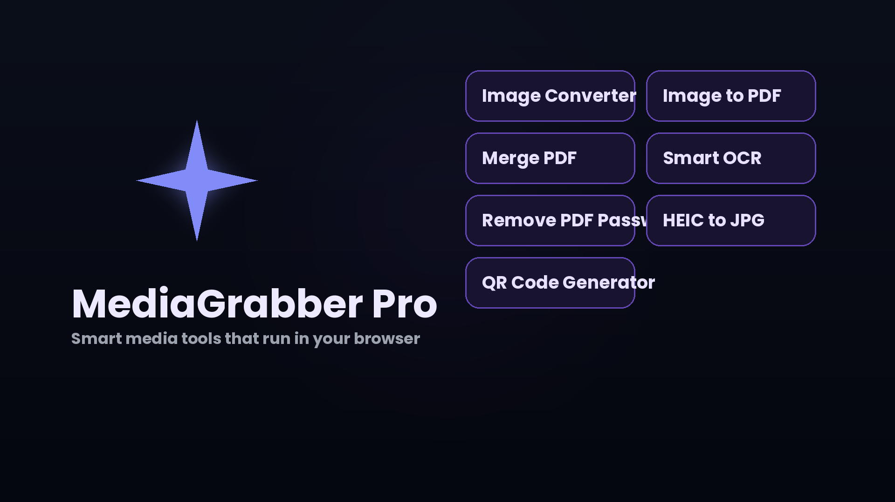
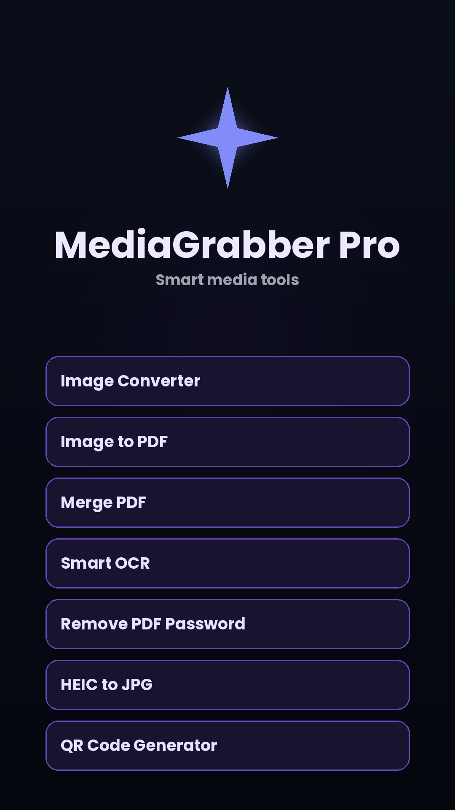

<div align="center">


# MediaGrabber Pro

### Free PDF & image tools that run 100% in your browser

**No uploads · No sign-up · No server · Your files never leave your device**

<br>

[](https://codemaster2013.github.io/converter/)
[](https://codemaster2013.github.io/converter/)
[](#-privacy)


<br>



</div>

<br>

## ✨ Why MediaGrabber Pro?

| 🔒 Private | ⚡ Fast | 📴 Offline | 📱 Installable |
| :---: | :---: | :---: | :---: |
| Everything happens on your device | No waiting for uploads or downloads | Works without internet after first visit | Add it to your phone or desktop like an app |

<br>

## 🧰 All Tools

### 📄 PDF Tools

| Tool | What it does |
| --- | --- |
| 🖼️ **Image to PDF / JPG to PDF** | Turn photos and images into one PDF |
| 🔗 **Merge PDF** | Combine many PDFs into one |
| 🗂️ **PDF Page Organizer** | Rotate, reorder, delete and split pages |
| ✍️ **Sign PDF** | Draw your signature and place it on a document |
| 🔓 **Unlock PDF** | Remove a password you already know |
| 🔐 **PDF Locker** | Add a password to a PDF |
| 📖 **PDF Reader** | Read and annotate PDFs |
| 🔄 **PDF Converter** | Word, PowerPoint, image and text to PDF, and back |
| 📷 **Document Scanner** | Camera straight to PDF |

### 🖼️ Image Tools

| Tool | What it does |
| --- | --- |
| 🔁 **Image Converter** | Convert between JPG, PNG and WebP |
| 🍎 **HEIC to JPG** | Open iPhone photos anywhere |
| 📉 **Compress to Size** | Hit an exact 100 KB, 50 KB or 20 KB target |
| 🪪 **Photo & Signature Resizer** | Exact pixels and KB for online forms |
| ✂️ **Remove Background** | Cut out the subject of a photo |
| 📍 **Remove EXIF / GPS** | Strip location data before sharing |
| 🔤 **Smart OCR** | Image to text, English and Hindi |

### 🧩 Utilities

| Tool | What it does |
| --- | --- |
| ▦ **QR Code Generator** | Make QR codes, no sign-up |
| 📸 **QR Code Scanner** | Scan with the camera or from an image |
| 🧬 **Base64 Converter** | Image to Base64 and back |

<br>

## 📱 App Experience

<table>
<tr>
<td width="50%" valign="top">

- 📲 Installable **PWA**
- 📴 **Offline** support
- 📤 **Share target**: send files from your phone's share sheet
- 🔗 Deep links to each tool (e.g. `?tool=ocr`)

</td>
<td width="50%" valign="top">

- 🌗 **Light and dark** mode
- 🎨 **16 app icon themes**: Classic, Forest, Space, Galaxy, Fire, Marble, Glow, Fur and more
- 🎬 Animated intro

</td>
</tr>
</table>

<div align="center">

| Light mode | Dark mode | Phone |
| :---: | :---: | :---: |
|  |  |  |

</div>

<br>

## 🛠️ Built With

Plain **HTML, CSS and JavaScript**. No framework, no build step. Libraries are bundled locally so everything works offline.

| Purpose | Library |
| --- | --- |
| PDF create / edit | pdf-lib, jsPDF |
| PDF rendering | PDF.js |
| OCR | Tesseract.js (English + Hindi data included) |
| HEIC conversion | heic2any |
| QR codes | qrcode, jsQR |
| ZIP handling | JSZip |
| Intro effects | three.js |
| Feedback / VIP pages | Firebase |

<br>

## 📁 Project Structure

<details>
<summary><b>Click to expand</b></summary>

```text
converter/
├── index.html              # Main app
├── *.html                  # Landing page per tool (jpg-to-pdf, merge-pdf, ...)
├── index (2..5).html       # Feedback, VIP and beta pages
├── tools.js                # Extra tools (compress, scanner, sign, EXIF, QR scan, ...)
├── pwa.js · sw.js          # PWA install logic and service worker
├── mg-*.js                 # Intro, deep links, icons, library loader
├── lib-*.js                # Bundled third-party libraries
├── *.traineddata.gz        # OCR language data (English, Hindi)
├── appicon-*               # Icon theme packs
├── manifest.webmanifest    # PWA manifest
├── sitemap.xml · robots.txt
└── 404.html · offline.html
```

</details>

<br>

## 🚀 Run Locally

Service workers and camera access need a server, so don't just double-click the file.

```bash
git clone https://github.com/codemaster2013/converter.git
cd converter
python3 -m http.server 8080
```

Then open **http://localhost:8080**

<br>

## 🌍 Deploy

Works on GitHub Pages, Vercel, Netlify or any static host.

**GitHub Pages:** Settings → Pages → Deploy from branch → `main` / root

> [!IMPORTANT]
> After changing any file, bump `CACHE_VERSION` at the top of `sw.js` so returning users get the update instead of a cached copy.

<br>

## 🔒 Privacy

All conversion, OCR, compression and editing happens **locally in your browser** using JavaScript and WebAssembly. Your files are never sent to a server.

<br>

## 🐞 Feedback

Found a bug or have an idea? [Open an issue](../../issues).

<br>

<div align="center">

**Made with ❤️ by [codemaster2013](https://github.com/codemaster2013)**

⭐ If you like the app, star the repo!

</div>
